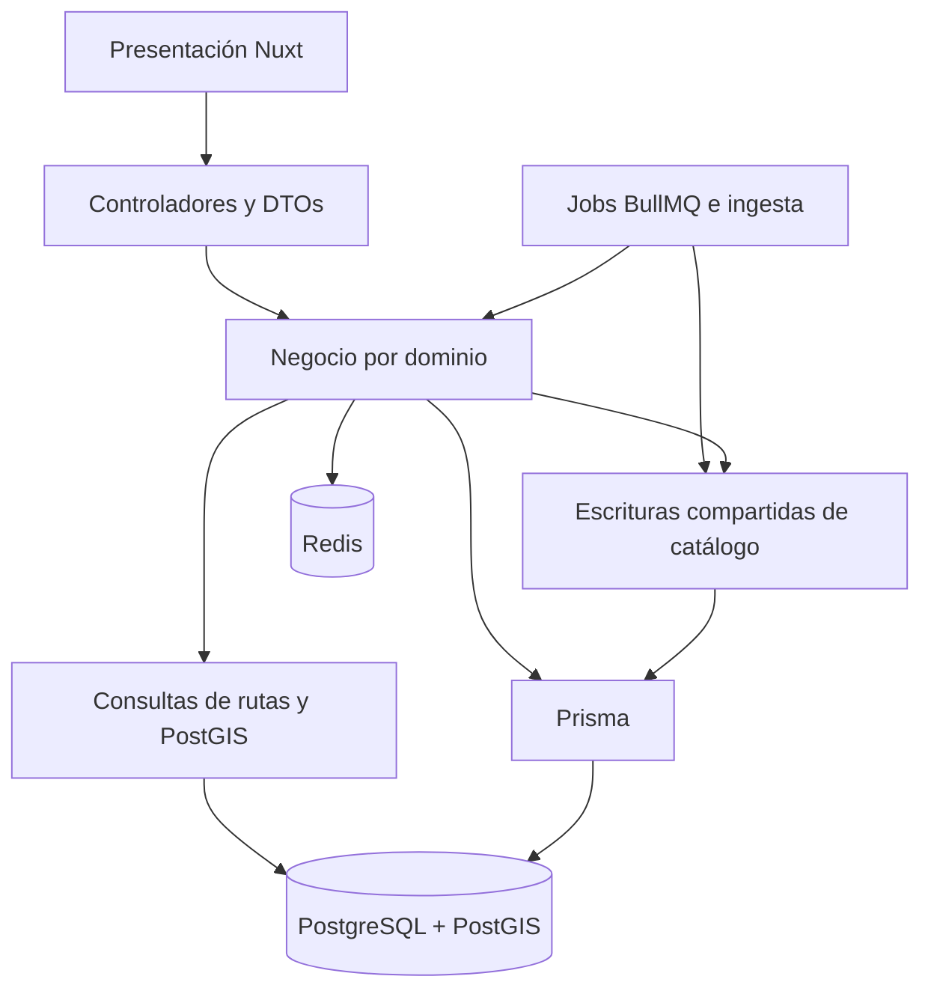

# Auditoría de legibilidad y arquitectura de FlyWise

## Resumen

FlyWise permite explorar rutas comerciales y administrar la ingestión de catálogos abiertos. La revisión asume administradores concurrentes y cargas OpenFlights por streaming; no certifica tráfico de producción ni 60 FPS. Referencia inicial: `a561287a4920c2b913b2ec3554a842fbd28a424b`.

El sistema está organizado por dominios y sus controladores son pequeños. La principal distancia respecto de N-Capas está en los módulos de negocio que conocen consultas y protocolos de persistencia. No falta una jerarquía de interfaces: falta concentrar algunas reglas y separar consultas complejas de su coordinación.

Se inspeccionaron controladores y escrituras de catálogos, consultas de rutas y proximidad, configuración y ejecución ETL, sesiones Redis, contrato de datos, migraciones y pruebas relacionadas. La lectura del frontend fue de su estructura y contratos de pruebas; no una revisión línea por línea. Las pruebas unitarias iniciales pasaron: 209 backend y 198 frontend.

## Hallazgos, de lo transversal a lo local

### Correcciones necesarias

1. **Las reglas espaciales y de configuración dependen de funciones propias de PostgreSQL.**
   - Qué es: el trigger de aeropuertos construye su ubicación y tres funciones validan JSON de ingesta.
   - Caso: escribir coordenadas desde un nuevo escritor requiere conocer que el trigger completa un campo obligatorio. Retirarlo sin adaptar administración, lotes y fixtures rompe las altas.
   - Evidencia inicial: `backend/prisma/functions.sql`, `triggers.sql` y los CHECK del contrato que llaman a `etl_valid_*`.
   - Mejora: escritura atómica de coordenadas y ubicación desde backend; validación NestJS en entradas internas y HTTP. Migración que conserva PostGIS y restricciones declarativas. Aplicada en esta rama.
   - Si se omite: no se cumple el requisito de retirar lógica propia de base de datos.

2. **El disparo ETL guarda errores internos de Redis.**
   - Qué es: la entrada de carga local y la de pipelines manejaban el mismo fallo de maneras distintas.
   - Caso: `queue.add` rechaza con un mensaje que contiene información de conexión; `triggerJob` lo persistía como mensaje visible del historial, mientras pipelines usaba un mensaje público fijo.
   - Evidencia inicial: bloque catch de `EtlService.triggerJob`, frente a `PipelinesService.enqueue` y `retry`.
   - Mejora: un solo módulo de encolado mantiene creación, reintentos, retención y mensaje público. Conserva inicio/fin nulos si el worker nunca arrancó. Aplicada.
   - Si se omite: el historial puede exponer detalles internos y ambas entradas divergen.

### Mejoras de mantenimiento

3. **Cada escritor repite el protocolo transaccional de catálogo.**
   - Qué es: administración e ingesta deben tomar el mismo bloqueo antes de modificar datos.
   - Caso: agregar una escritura y olvidar el bloqueo permite competir con una importación aunque las otras entradas sí lo usen.
   - Evidencia: escrituras administrativas de aeropuertos, aerolíneas, rutas/ofertas y flush ETL.
   - Mejora: `escribirCatalogo` concentra transacción, bloqueo y traducción de conflictos; `proteccionManual` concentra la decisión de proteger cambios. Los recálculos permanecen explícitos donde son necesarios para no recalcular todo por cada lote. Aplicada.
   - Si se omite: cada nuevo escritor debe recordar el mismo protocolo. El module gana depth al reducir su interface; el seam sigue siendo la operación funcional, no un repositorio genérico. Produce locality para mantenimiento y leverage para sus callers.

4. **Rutas mezcla selección espacial/relacional con respuesta y administración.**
   - Qué es: el mismo archivo coordinaba operaciones, SQL de ranking, includes y adaptación al mapa.
   - Caso: cambiar visibilidad requiere localizar tanto la consulta SQL que selecciona pares como la consulta ORM que carga ofertas.
   - Evidencia: consultas originales `includeRouteDetails` y `global` del módulo de rutas.
   - Mejora: agrupar consultas en `route-queries`, manteniendo la selección limitada en PostgreSQL. Aplicada. No se introdujo una DSL para traducir predicados ORM a SQL.
   - Si se omite: la lectura obliga a recorrer reglas ajenas al cambio. Persiste duplicación semántica entre ranking, ORM y contador: debe comprobarse con pruebas de archivo. La mejora aporta locality; no elimina por sí sola todo acoplamiento al adapter Prisma.

5. **La creación interna de pipelines tenía validación menos completa que HTTP.**
   - Qué es: el DTO HTTP cubría tipos/rangos, mientras el método interno llamaba directamente a la validación semántica.
   - Caso: un caller interno podía pasar un tamaño de lote fuera de rango; la base terminaba rechazándolo mediante una función que ahora debe retirarse.
   - Evidencia: `PipelinesService.create`, comparado con `update` y `validateConfiguration`.
   - Mejora: usar también ValidationPipe y el DTO existente al crear. Probar entradas internas inválidas además de HTTP. Aplicada; no se añadió otro esquema de validación.
   - Si se omite: retirar funciones dejaría una entrada sin validación equivalente.

6. **Una suite HTTP no construía todas las dependencias del módulo probado.**
   - Qué es: las pruebas administrativas importaban AirportsModule sin el proveedor Redis requerido por AirportsService.
   - Caso: el contenedor de Nest fallaba antes de ejecutar cualquier solicitud, aunque las pruebas unitarias pasaban.
   - Evidencia: ejecución de administración de catálogos sobre la copia de PostgreSQL.
   - Mejora: importar RedisModule en ese montaje de integración y comprobar alta/edición parcial seguida de consulta por proximidad. Aplicada.
   - Si se omite: la suite no protege la migración espacial.

## Mejoras sugeridas y decisiones de alcance

- Mantener los controladores como adapters HTTP delgados; suprimirlos no elimina complejidad útil. PrismaService posee el ciclo de conexión, por lo que su tamaño pequeño no es un defecto.
- Conservar el SQL de lotes, resolución de identidades, ranking y PostGIS: reemplazarlo por N consultas por fila empeora coste y atomicidad. Las recomendaciones no equivalen a eliminar toda consulta manual.
- No abstraer la rotación Redis de sesiones: su script atómico responde a concurrencia real. El requisito de retirar funciones se aplica a PostgreSQL propio, no a retirar operaciones atómicas necesarias de Redis.
- Una separación posterior de las escrituras por dominio debe demostrar que reduce conocimiento de persistencia en callers. No crear interfaces con un único adapter solo para imitar SOLID.
- Una falla entre finalizar el worker y persistir su evento sigue siendo una oportunidad de endurecimiento transaccional; no se declara una garantía de atomicidad entre PostgreSQL y Redis.
- Medición final: +17 líneas TypeScript de producción al trasladar reglas; no se añadió ninguna dependencia. Resultados detallados en el informe de verificación.

## Review de arquitectura N-Capas

| Responsabilidad propuesta | Estado | Evidencia y distancia restante |
|---|---|---|
| Presentación en frontend | Presente | Nuxt consume HTTP; falta verificación visual manual en esta auditoría. |
| Entrada HTTP | Presente | Controladores delegan, DTOs validan; no es una segunda capa de negocio. |
| Negocio | Parcialmente separado | Protección y coordinación más localizadas; servicios todavía importan Prisma y excepciones HTTP. |
| Acceso a datos | Parcialmente separado | Consultas complejas de rutas agrupadas; escrituras ORM siguen en módulos de dominio. |
| Ingesta | Módulo transversal | Streams y lotes, con escritura compartida; no es una capa entre negocio y datos. |
| Caché | Infraestructura transversal | Redis sirve caché, sesiones y colas; no toda operación Redis es caché. |
| Lógica propia en PostgreSQL | Retirada por migración | Deben desplegarse escritores nuevos y detener procesos antiguos antes de retirar funciones. |

**Veredicto:** arquitectura modular con separación parcial de capas. Los cambios reducen protocolos duplicados y dependencia de funciones propias, pero no convierten el dominio en independiente de NestJS/Prisma. Esa independencia estricta no fue el objetivo aprobado. La siguiente inversión debe justificarse por cambios reales que crucen módulos, no por un porcentaje arbitrario de cumplimiento.

No comprobado aquí: carga concurrente de producción, rendimiento GPU y revisión visual manual. Resultados finales de compilación, integración y revisión independiente: [informe de verificación](verificacion-mantenibilidad-n-capas.md).
