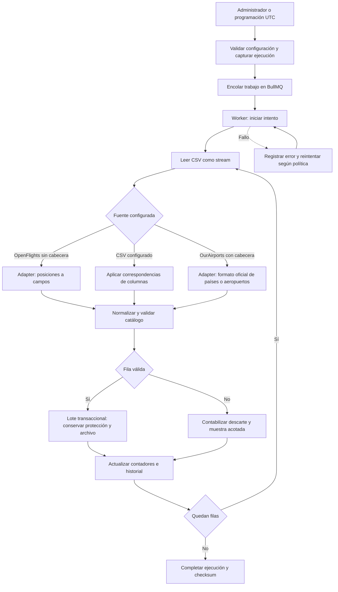
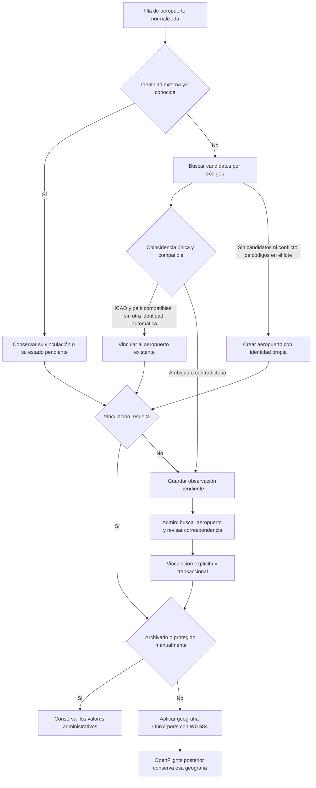
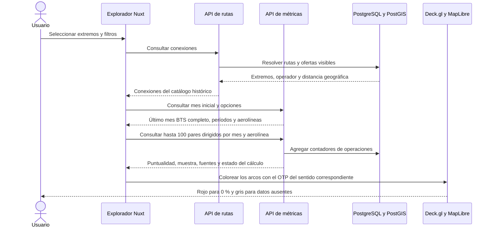

# Flujos principales de FlyWise

Diagramas del sistema implementado. El spec define las ampliaciones por ticket.

## Ingesta de catálogos

## Correspondencias entre catálogos

Los identificadores se interpretan dentro de su fuente. Una coincidencia de IATA con ICAO o país contradictorios requiere revisión. El administrador puede vincular explícitamente alias que no se aceptan automáticamente.

Las correcciones, retiros y restauraciones de operaciones conservan el historial y encolan el recálculo de las combinaciones afectadas. El mapa conserva el último valor válido mientras la combinación está pendiente. Ver la [verificación de operaciones y métricas](verification-03.md) y la [verificación del mapa](verification-07.md).

## Consulta de rutas y mapa

